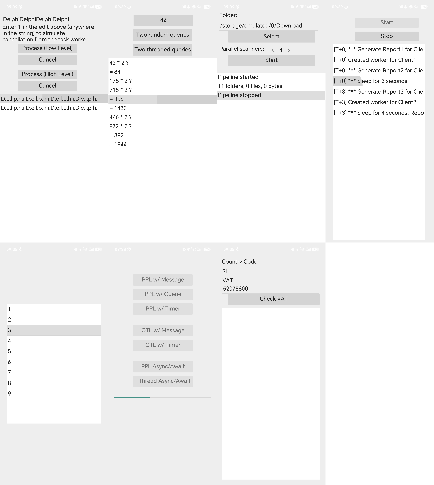

# OmniThreadLibrary-NG FMX Examples

This repository contains example code adapted from [OmniThreadLibrary-NG](https://github.com/gabr42/OmniThreadLibrary-NG), originally written for the VCL framework.

I have migrated these examples to the **FMX (FireMonkey)** framework. The migration covers basic setup and test verification only — the code has **not** been extensively or thoroughly tested.

## Notes

- Original examples: VCL framework (from OmniThreadLibrary-NG)
- This repository: FMX framework migration
- Testing status: basic installation and verification only, not heavily tested

## Disclaimer

Use at your own risk. The FMX migration is provided as-is, with only light validation. If you find issues, contributions and fixes are welcome.

## Credits

All original example code belongs to the OmniThreadLibrary-NG project and its authors.
